<div align="center">


[](https://zyvorai.github.io/zeus-os/)
[](#status)
[](#why-zeus-os)
[](#install)
[](docs/customer/enterprise-sso.md)
[](#install)
[](#license)

[](https://zyvorai.github.io/zeus-os/)
[](#every-feature)
[](#quickstart)
[](https://github.com/zyvorai/zeus-os/releases)

### See every VM. Move it, secure it, cost it. From one place.

**The visual control plane for KubeVirt virtual machines and Kubernetes infrastructure.** A web dashboard, a terminal UI, a CLI and an API, all driven by one engine, so they always agree.

**KubeVirt-native** · **Four interfaces, one engine** · **Auth on by default** · **Multi-tenant** · **Honest about previews**

📖 **[Read the full docs](https://zyvorai.github.io/zeus-os/)**: getting started, admin basics, enterprise SSO and a page-by-page guide.

🔎 **[Try the live demo](https://zeus.zyvor.dev)**: sign in as `viewer` with the password `Zeus-Live-Demo-Viewer-2026!`. It is a shared, read-only copy on a small test cluster with a few tiny VMs; you can look at everything the viewer role may see, but not change anything.

</div>

---

> **This repository distributes binaries, container images, the Helm chart and documentation. It contains no source code.**
> <a id="status"></a>**Status: preview.** The Helm chart (`oci://ghcr.io/zyvorai/charts/zeus-os`) and the container image (`ghcr.io/zyvorai/zeus-os-web`) are public so you can try it, but there is no signed release yet: no checksums, signatures or SBOM, and no standalone binaries. Watch [Releases](https://github.com/zyvorai/zeus-os/releases). Where a feature is partial, the product and its docs say so.

## What it does

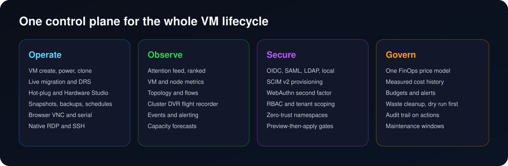

## See it

Real captures from a running Zeus OS lab (a small single-node cluster with one test VM, so counts are modest). Light theme shown; a Dark theme ships too. Every page is a flowing web page: big numbers, hairline sections and real data, with nothing boxed in or cut off. Unknown values show a dash, never an invented zero.

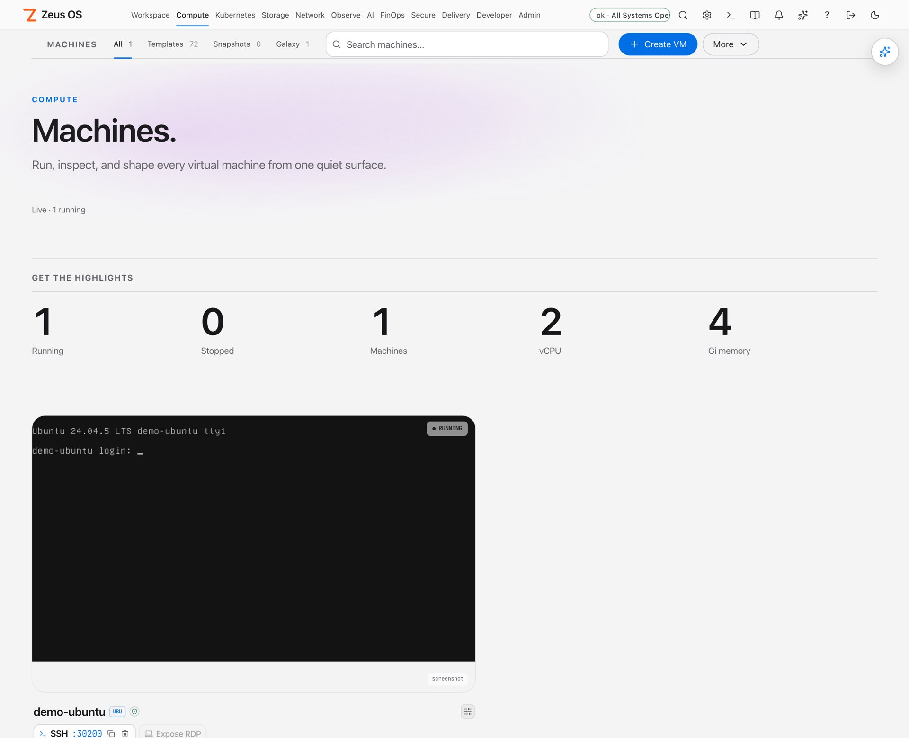

**Machines.** Highlights, search and the one primary action on top; each VM shows its real console screenshot (a VM with none says so, instead of drawing a fake one). Click a VM to open its own full page.

### Dark theme, in motion

| | |
|---|---|
| 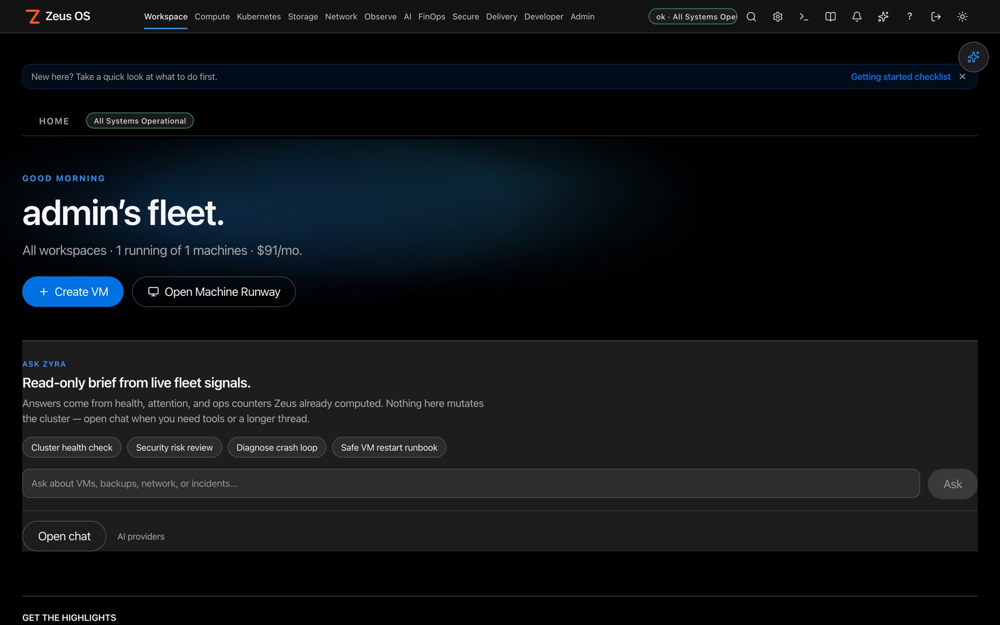<br>**Home.** Fleet status, an Ask Zyra brief built from signals Zeus already computed, and the headline numbers. | 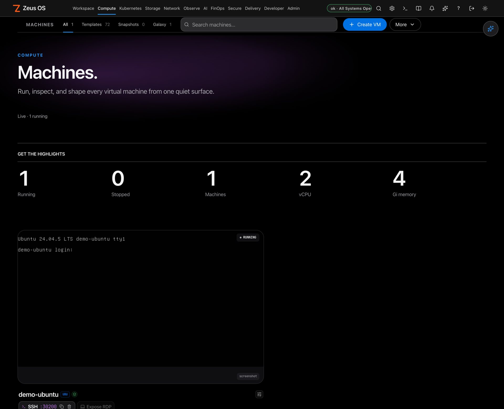<br>**Machines.** Same page, dark theme: large numerals, the real console screenshot, no boxes around sections. |

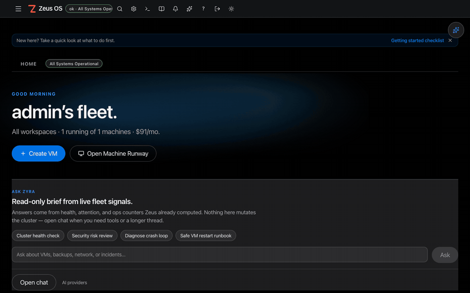

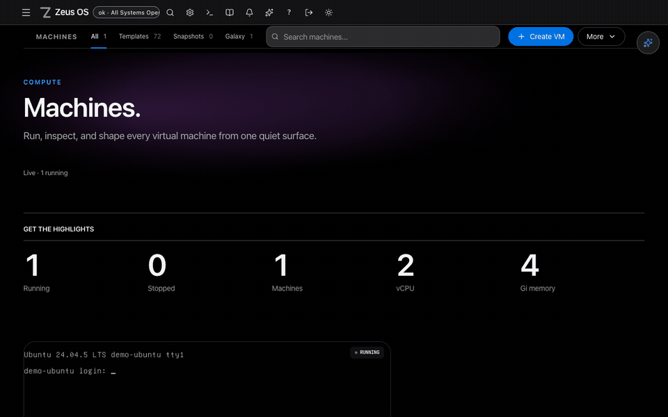

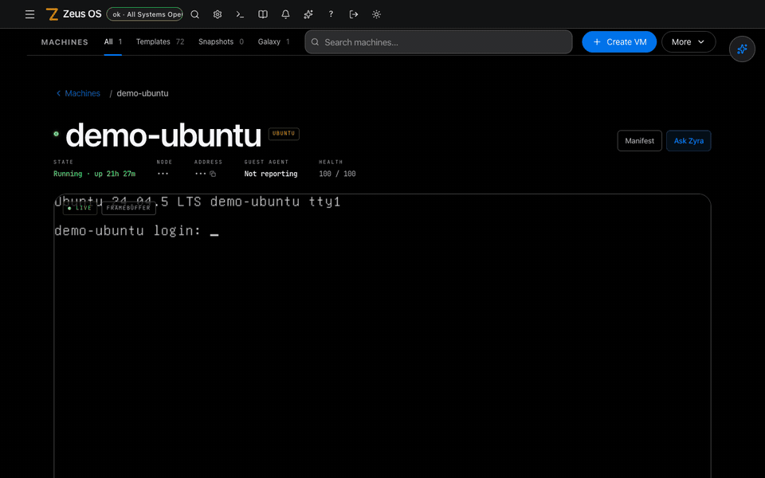

IP addresses and node names are masked in these captures.

### More pages

| | |
|---|---|
| 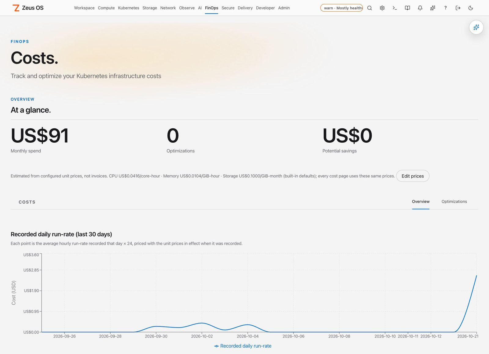<br>**Costs.** Monthly spend and savings from one price model you configure, with the recorded run-rate over time. Estimates, not invoices. | 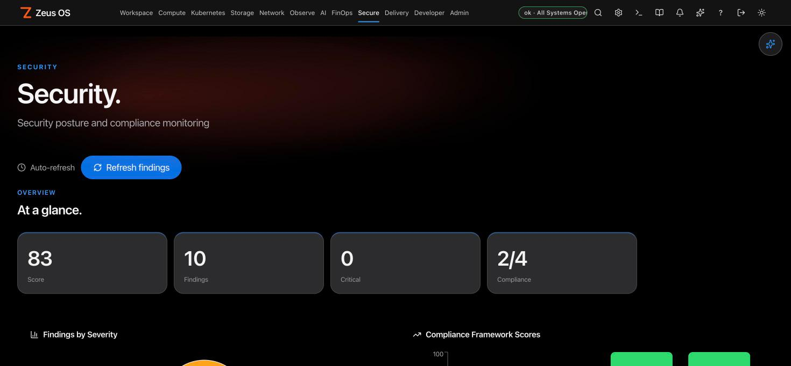<br>**Security.** Posture score, findings by severity and compliance framework scores. |
| 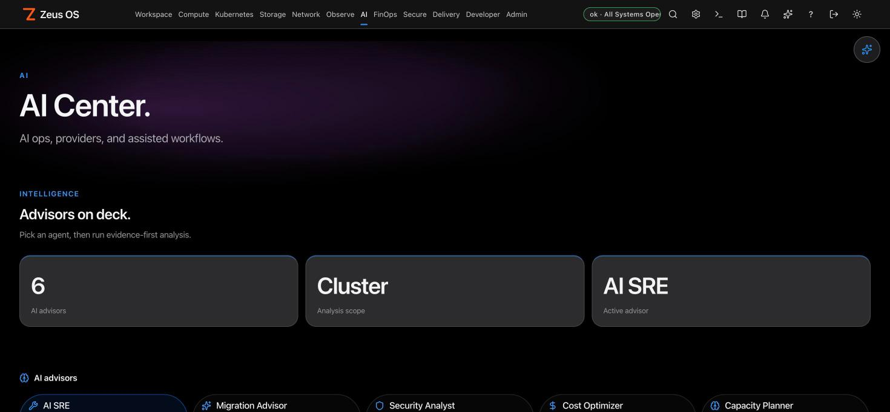<br>**AI Center.** Six advisors (AI SRE, Migration, Security, Cost, Capacity, Network) with evidence-first analysis. | 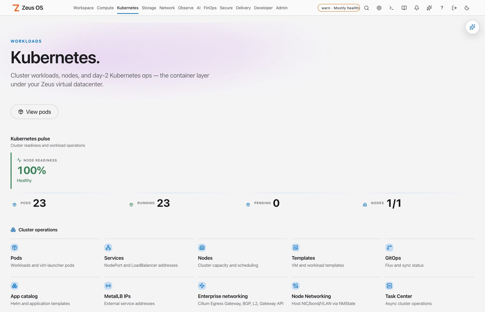<br>**Kubernetes.** Node readiness, pod counts and every day-2 surface for the container layer, one click away. |
| 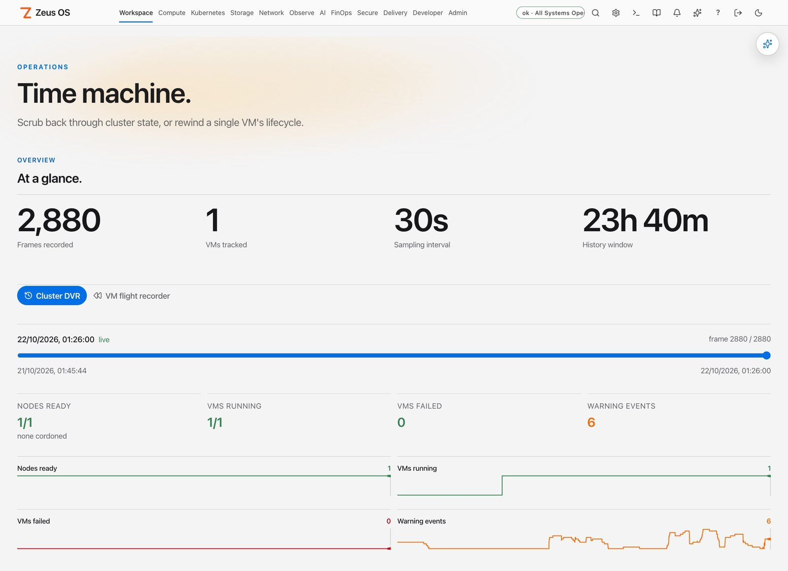<br>**Time machine.** Scrub the cluster back through recorded frames, or rewind a single VM's lifecycle. | |

## Why Zeus OS

| When this happens... | Zeus OS gives you... |
|---|---|
| Running KubeVirt means living in `kubectl` and YAML | A visual VM command center, plus a terminal UI and CLI for the same operations |
| Nobody can say what a VM costs | One price model across every cost page, measured cost history, budgets and waste detection that starts as a dry run |
| Consoles are scattered across tools | VNC and serial in the browser, native RDP and SSH through your own client |
| You need to move a running VM or level a cluster | Live migration and DRS auto-rebalance with cooldowns and an audit trail |
| Different teams share one cluster | Tenant-scoped views, quotas and role-based access |
| Sign-in has to fit your identity provider | Local, LDAP, SAML and OIDC, SCIM v2 provisioning and WebAuthn security keys |
| Something is wrong and you do not know where to look | A ranked Attention feed, a cluster flight recorder (DVR), events and alerting |
| You want an assistant, not another chatbot | Ask Zyra answers from your cluster and your own docs, with citations; private code stays out of remote models unless you allow it |

Unknown values are shown as unknown, never as zero, and features that are only partly built carry a preview banner.

## How it fits together

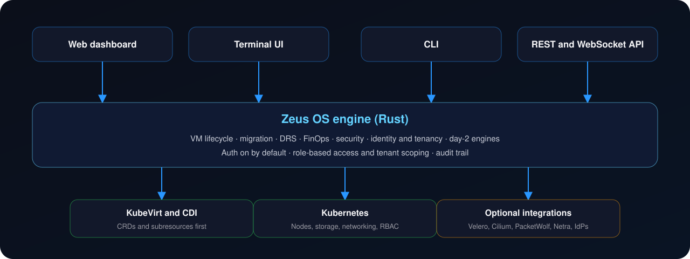

Zeus OS uses KubeVirt and CDI custom resources and subresources first, rather than shelling out to `virtctl`. Optional integrations (Velero backups, Cilium networking, PacketWolf and Netra network views, identity providers) are switched on when you configure them.

## Every feature

Every feature in the current product, one by one: **146 features across 19 groups**. Features marked `Preview` or `Partial` have documented limits, stated in the row; unknown values are shown as unknown, never as zero. Full copy: [docs/FEATURES.md](docs/FEATURES.md).

<details>
<summary><b>1. VM Lifecycle & Fleet Operations</b> (15)</summary>

_Create, run, migrate, and manage KubeVirt virtual machines at fleet scale without touching kubectl._

| Feature | What it does |
|---|---|
| **VM Command Center** | Browse, filter, and operate every KubeVirt VM and running instance from one inventory with power, pause, restart, and detail drill-down. |
| **VM Workbench & Power Actions** | Start, stop, restart, pause, and delete VMs from a dedicated workbench separated from read-only browse views. |
| **VM Setup & Template Wizard** | Guided creation from instance types, preferences, and templates with cluster-grounded, AI-assisted manifest generation. |
| **Templates & Instance Type Catalog** | Curated VM templates, KubeVirt instance types, and preferences browsable and one-click deployable. |
| **Hot-Plug CPU, Memory & Disks** | Add vCPU, RAM, and data disks to running VMs live without a reboot. |
| **NIC Model Selection** | Choose VirtIO or e1000e per network interface, at creation or on an existing VM. |
| **Virtual Devices & Memory Overcommit** | Toggle watchdog, VirtIO RNG, sound, USB tablet, serial console, and the virtio memory-balloon device per VM. |
| **Live Migration Assistant** `Preview` | Plan and start live VM migrations with a guided wizard. Some pre-checks are estimates and the target node is not yet passed to KubeVirt. |
| **Migration Factory** `Partial` | Batch-migrate and convert VMs, including disk conversion, across nodes and storage as a supervised campaign. Cross-cluster migration is not implemented yet. |
| **VM Groups & Fleet Bulk Ops** | Organize VMs into logical groups and apply power, tagging, and lifecycle actions in bulk. |
| **VM Clone & Compare** | Clone VMs from running state or snapshots and diff two VMs' configuration side by side. |
| **VM Health & Repair** | Per-VM health scoring plus guided repair actions for stuck, unschedulable, or degraded instances. |
| **Windows Enterprise & Licensing** | Windows guest customization, sysprep, and license tracking for Windows VM estates. |
| **Windows via Kryton** | Optional Kryton REST catalog for Windows create + golden factory (12 dockur IDs); Zeus keeps day-2 VNC/native RDP/GuestKit. |
| **Guest Intelligence** | Reads guest-agent data for OS, IPs, installed software, and in-guest state. |

</details>

<details>
<summary><b>2. Consoles & Remote Access</b> (7)</summary>

_Live VNC, serial, terminal, RDP, and SSH access with real-time metrics — all in the browser._

| Feature | What it does |
|---|---|
| **VNC Graphical Console** | Full graphical VM console streamed over WebSocket, including a pop-out standalone window. |
| **Serial Console** | Live serial-port console for headless VMs and boot-time troubleshooting. |
| **Native RDP & SSH (NodePort expose)** | One-click expose of RDP or SSH over a NodePort (a free port is assigned and collisions are rejected), then connect with your own client using a downloadable .rdp file or an ssh command. |
| **Console Hub & Workspace** | Multi-console workspace with tabs, session management, and a unified console launcher. |
| **Live Console Metrics** | Real-time CPU, memory, disk, and network telemetry streamed alongside each console. |
| **Console Session Recording & Sharing** | Record, replay, and share console sessions for training, audit, and collaboration. |
| **In-Browser Terminal** | Cluster and pod terminal access with WebSocket-backed shells. |

</details>

<details>
<summary><b>3. Networking & PacketWolf VM Shield</b> (12)</summary>

_See exactly what a VM talks to and contain it in one click — kernel-native visibility and enforcement._

| Feature | What it does |
|---|---|
| **PacketWolf VM Shield** | Unified per-VM network visibility and one-click containment with desired-vs-actual verification and a background reconciler. |
| **Live Flow Watch (Hubble)** | Streams a VM's live allowed/denied flows, dependency map, public-exposure findings, and an explainable risk score. |
| **Containment Profiles** | Internet lock, full quarantine, lateral lock, exfiltration lock, and investigation mode — with optional termination of existing connections. |
| **Policy Preview & Dry-Run** | Dry-runs the exact containment policy against recorded traffic to show what it will and won't break. |
| **Per-VM Firewall & Egress Control** | Block specific outbound ports (SMB, RDP, C2) and manage per-VM firewall rules from a panel. |
| **Cilium Dashboard** | Visualize Cilium identities, endpoints, and network policy enforcement across the cluster. |
| **Network Policy Builder** | Visually author, simulate, and apply Kubernetes and Cilium network policies. |
| **Network Flow & Observability** | Cluster-wide network flow maps, attachments (Multus), and traffic observability. |
| **Service Mesh & Ingress** | Manage service mesh routing, ingress rules, service discovery, and full MetalLB IPAddressPool/L2Advertisement CRUD (create and delete pools, not just view). |
| **VM-Aware Ingress** | Create, validate, and delete Ingress rules for a VM's exposed Service directly from the VM inspector, with TLS-secret and host-conflict checks before you apply. |
| **Host Networking (NMState)** | Declare NIC/bond/VLAN configuration for cluster nodes and see per-node apply status, via the kubernetes-nmstate operator. |
| **DNS & IPAM** | Cluster DNS records and IP address management for VMs and services. |

</details>

<details>
<summary><b>4. Storage & Data</b> (8)</summary>

_Manage DataVolumes, disks, PVCs, images, and storage migration for the whole VM estate._

| Feature | What it does |
|---|---|
| **Storage Explorer** | Unified view of storage classes, PVCs, volumes, and capacity across the cluster. |
| **DataVolumes & CDI Import** | Create and import DataVolumes from URLs, registries, and uploads via the CDI upload flow. |
| **Disk Manager & Hot-Plug** | Add, resize, and hot-plug VM disks including live PVC resize. |
| **Image Library, Factory & Registry** | Curate boot images, build images with the Image Factory (Zeus ISO pipelines and optional **Build with Kryton**), and browse the image registry. |
| **Storage Migration** | Move VM volumes between storage classes and backends with supervised migration. |
| **Volume Snapshots** | Point-in-time volume snapshots integrated with the snapshot manager. |
| **Storage Intelligence** | Analytics on storage usage, waste, and growth trends with optimization hints. |
| **Atlas Distributed Storage** | Read-only Ceph/NFS backend, cluster, and pool inventory proxied from Atlas (the Zyvor storage control plane), surfaced on the Storage page. |

</details>

<details>
<summary><b>5. Cost, FinOps & Optimization</b> (8)</summary>

_Per-VM cost visibility, waste detection, forecasting, chargeback, and rightsizing._

| Feature | What it does |
|---|---|
| **Cost Intelligence Dashboard** `Partial` | Per-VM and per-namespace cost from a price model you configure, with trends and drill-down. A model, not billing data. |
| **Chargeback & Cost Allocation** | Allocate spend to tenants, teams, and projects with a chargeback engine and reports. |
| **Waste Detection & Rightsizing** | Finds idle, oversized, and orphaned resources and recommends right-sized shapes. |
| **Cost Forecasting** | Projects future spend from usage trends and growth models. |
| **Budget Alerts** | Server-side monthly budgets per cluster, tenant or namespace, evaluated from recorded cost history, with one alert per threshold per month through your notification channels. Estimates from configured unit prices, not invoices. |
| **Spot & Savings Advisor** | Identifies spot and savings-plan opportunities for eligible workloads. |
| **Optimization Center** | Consolidated hub of cost, capacity, and performance optimization recommendations. |
| **Cost Estimator** | Pre-deployment cost estimation for planned VMs and workloads. |

</details>

<details>
<summary><b>6. Capacity, Autoscaling & Placement</b> (10)</summary>

_Plan headroom, schedule smartly, and scale nodes, pods, and VMs automatically._

| Feature | What it does |
|---|---|
| **Capacity Planning** | Cluster and node capacity dashboards with headroom, saturation, and what-if analysis. |
| **Cluster Autoscaling** | Configure and observe node autoscaling behavior and scale events. |
| **HPA & VPA Managers** | Manage Horizontal and Vertical Pod Autoscalers with recommendations. |
| **Placement Advisor** | Recommends optimal nodes for VMs using affinity, taints, and resource fit. |
| **Affinity, Taints & Tolerations** | Author affinity/anti-affinity rules, node taints, and tolerations visually. |
| **Priority & Runtime Classes** | Manage PriorityClasses, RuntimeClasses, and Pod Disruption Budgets. |
| **Utilization Heatmap** | Cluster-wide heatmap of resource pressure across nodes and namespaces. |
| **Node & HA/DRS Management** | Node inventory, cordon/drain, and HA/DRS workload balancing, from suggest-only to fully automated, with a per-VM cooldown against thrashing and a full history of what the engine moved and why. |
| **Manual Node Fencing** | Force-remediate a node you have confirmed dead out of band: cordon it and force-delete its VM instances so KubeVirt reschedules them elsewhere. Needs an explicit opt-in and a "node is dead" confirmation, and refuses on any node still reporting Ready. |
| **GPU & Device Plugins** | Manage GPU dashboards, device plugins, and hardware device attachment, including a vGPU mediated-device profile picker with a manual-resource fallback when no GPU hardware is present. |

</details>

<details>
<summary><b>7. Observability, Topology & Time Machine</b> (9)</summary>

_Topology maps, distributed tracing, logs, metrics, and point-in-time cluster history._

| Feature | What it does |
|---|---|
| **Topology & Dependency Graph** | Interactive maps of nodes, VMs, pods, services, and their dependencies. |
| **Cluster DVR & VM Flight Recorder** | Time Machine that continuously samples cluster and per-VM state for point-in-time replay. |
| **Distributed Tracing & APM** `Partial` | Service list, request rate and error rate from PacketWolf flows. Latency percentiles are shown only when measured, otherwise unknown. |
| **Logs Explorer & Aggregation** | Centralized log search and aggregation across pods and VMs. |
| **Metrics & Custom Metrics** | Real Prometheus-backed metrics, custom metric dashboards, and monitoring targets. |
| **Anomaly Detection** | Detects abnormal resource, cost, and behavior patterns automatically. |
| **Timeline & Gantt View** `Partial` | Chronological timeline of events and remediation actions, and Gantt-style operation views. |
| **Event Analysis** | Correlates and analyzes Kubernetes events for root-cause signals. |
| **System Health & Status Page** | Overall cluster health scoring and a shareable status page. |

</details>

<details>
<summary><b>8. Security Posture & Vulnerability</b> (7)</summary>

_Continuous posture scoring, image scanning, secrets, and a dedicated security operations center._

| Feature | What it does |
|---|---|
| **Security Posture & Overview** | Continuous scoring of cluster and VM security posture with prioritized findings. |
| **Vulnerability & Image Scanning** | Scans container and VM images for CVEs with severity breakdowns. |
| **Security Operations Center** | Consolidated SecOps view of threats, containment actions, and response state. |
| **Secrets & External Secrets** | Manage Kubernetes secrets and External Secrets Operator integrations. |
| **Certificate Manager** | Track, issue, and rotate TLS certificates across the cluster. |
| **eBPF & Kernel Intelligence** | Kernel-level (eBPF) runtime signals and kernel info for deep security context. |
| **Patch Center** `Partial` | Patch readiness checks and patch planning. Zeus OS does not execute patches yet. |

</details>

<details>
<summary><b>9. Compliance, Governance & Admission Control</b> (8)</summary>

_Frameworks, policy engines, admission webhooks, and RBAC visualization for provable control._

| Feature | What it does |
|---|---|
| **Compliance & Frameworks** | Continuous compliance checks mapped to frameworks with pass/fail evidence. |
| **OPA Gatekeeper & Zeus Policies** | Manage OPA Gatekeeper constraints and native Zeus policy definitions. |
| **Admission Control** | Configure admission webhooks and validate resources before they're admitted. |
| **Policy Simulation & Violations** | Simulate policy impact and track live policy violations. |
| **RBAC Visualizer** | Visual map of roles, bindings, service accounts, and effective permissions. |
| **Audit Log & Trail** | Immutable audit trail of every action across surfaces. |
| **Resource Governance & Quotas** | Resource quotas, limits, and governance policy across namespaces and tenants. |
| **Resource Tagging** | Consistent tagging and labeling for ownership, cost, and policy. |

</details>

<details>
<summary><b>10. Day-2 Automation & Remediation</b> (7)</summary>

_Closed-loop remediation, scheduled operations, workflows, and macros that run the boring parts._

| Feature | What it does |
|---|---|
| **Day-2 Closed-Loop Remediation** | Background engine that detects signals and runs remediation playbooks with a kill-switch. |
| **Auto-Remediation Playbooks** | Registry of remediation playbooks with signal-to-action mapping and audit. |
| **Scheduled Operations** | Schedule power on/off, snapshots, and other operations on cron-like cadences. |
| **Workflow Automation & Manager** | Compose multi-step operational workflows across resources. |
| **Macros & Batch Actions** `Preview` | Bulk operations across many resources. Macro recording and replay is not yet available. |
| **Task Center** | Central queue of running, scheduled, and completed operational tasks. |
| **Undo & Rollback** | Rollback and undo support for reversible operations. |

</details>

<details>
<summary><b>11. Incident Response & War Room</b> (7)</summary>

_Auto-assembled war rooms, guided response wizards, RCA, and SLA/SLO tracking._

| Feature | What it does |
|---|---|
| **Incident Center** | Track active incidents with severity, timeline, and correlated context. |
| **War Room Auto-Assembly** | Automatically assembles topology, logs, metrics, and RCA context for an active incident. |
| **Incident Response Wizard** | Guided, step-by-step response flows with recommended remediation. |
| **Incident Chat** | In-context collaboration thread tied to an incident. |
| **SLA Dashboard & SLO Manager** | Define and track SLOs, error budgets, and SLA compliance. |
| **Alerting & Notifications** | Alert rules, Prometheus rules, notification routing, and an alerting engine. |
| **Executive Briefing** | Auto-generated briefings summarizing state, risk, and incidents for leadership. |

</details>

<details>
<summary><b>12. GitOps, CI/CD & Change Management</b> (7)</summary>

_Argo/Flux sync, Helm and Kustomize, progressive delivery, and gated change approval._

| Feature | What it does |
|---|---|
| **GitOps Sync (Argo/Flux)** `Partial` | Read-only view of Flux and Argo CD sync state and drift for objects that already exist in the cluster. |
| **Helm & Kustomize** | Browse and manage Helm releases and Kustomize overlays. |
| **Progressive Delivery** | Canary, blue-green, and progressive rollout strategies with health gating. |
| **CI/CD Pipelines** | View and integrate CI/CD pipeline status for delivered workloads. |
| **Change Approval & Approvals** | Gate risky changes behind approval workflows before they execute. |
| **Infrastructure as Code** | Manage IaC definitions and environment configuration for the estate. |
| **Environment Management** | Model and manage dev/stage/prod environments and promotion. |

</details>

<details>
<summary><b>13. Backup, DR & Snapshots</b> (5)</summary>

_Velero-backed backups, disaster recovery orchestration, and scheduled VM snapshots._

| Feature | What it does |
|---|---|
| **Backup & DR Center** | Configure and monitor VM/cluster backups with a guided backup wizard. |
| **Velero Integration** | Native Velero backup and restore management for Kubernetes and VM resources. |
| **Disaster Recovery Orchestration** `Partial` | DR plans with measured RPO and a real restore test into a scratch namespace. Failover and execute steps are simulated and labelled as such. |
| **Snapshot Manager & Scheduling** | Take, browse, and restore VM snapshots on demand or on a schedule. |
| **Restore Wizard** | Guided restore of VMs and volumes from backups and snapshots. |

</details>

<details>
<summary><b>14. Multi-Cluster, Multi-Tenancy & Enterprise Identity</b> (8)</summary>

_Fleet-wide operations, tenant isolation, OIDC/LDAP/SAML/MFA, API tokens, and SIEM._

| Feature | What it does |
|---|---|
| **Multi-Cluster Fleet** `Partial` | Register remote clusters, connect, probe health and compare counts per cluster. Moving VMs between clusters is not implemented yet. |
| **Multi-Tenancy** | Namespace-label-based tenant isolation with per-tenant filtering across views. |
| **Enterprise SSO (OIDC/LDAP/SAML)** | Pluggable authentication with OIDC, LDAP, SAML, and local modes; local admin stays available as an automatic break-glass fallback whenever SSO is active. Verified live against a real Keycloak realm. |
| **Identity Center & User Management** | Manage users, roles, sessions, and identity policy with session revocation. |
| **API Tokens & Scoped Access** | Issue scoped API keys and bearer tokens for automation and integrations. |
| **SIEM & Auth Audit** | Stream auth and audit events to SIEM systems with a dedicated auth-audit view. |
| **Log Shipping** | Forward virt-launcher pod logs to Loki or a generic HTTP endpoint, filterable by namespace or VM, with no in-cluster collection agent. |
| **Provider Portal** | Multi-tenant provider/operator portal for managed-service delivery. |

</details>

<details>
<summary><b>15. AI Ops, Marketplace & Developer Center</b> (8)</summary>

_Built-in evidence-first LLM, copilots, blueprints, marketplace, and a developer toolkit._

| Feature | What it does |
|---|---|
| **AI Center & Copilot** | Built-in LLM (in-cluster Ollama or Forge gateway) for evidence-first, auditable assistance. |
| **Autonomous AI Ops** | AI-driven analysis, troubleshooting, and recommendation generation grounded in live cluster state. |
| **Natural-Language Command & Search** | NLP-driven command bar and universal search across the estate. |
| **RAG Template Catalog** | Retrieval-augmented generation over the template catalog using Qdrant and local embeddings. |
| **Marketplace & Blueprints** | Browse and deploy application blueprints and marketplace workspaces. |
| **Application & Service Catalog** | Curated catalog of applications, operators, and services to deploy. |
| **Developer Center & Playground** | API docs, API playground, GraphQL, webhook tester, and debug tools. |
| **Plugins & Custom Resources** | Extend Zeus OS with plugins and manage arbitrary Kubernetes custom resources. |

</details>

<details>
<summary><b>16. Edge, Chaos, Performance & Platform Ops</b> (8)</summary>

_Edge fleets, chaos experiments, performance testing, database ops, and cluster lifecycle._

| Feature | What it does |
|---|---|
| **Edge Center** | Manage distributed edge clusters and remote-site workloads. |
| **Chaos Engineering** | Design and run fault-injection experiments to test resilience. |
| **Performance Testing & Profiling** | Load, performance testing, and profiling for workloads and VMs. |
| **Database Operations** | Manage database workloads and operators from a dedicated DB ops surface. |
| **Operators Hub** | Discover, install, and manage Kubernetes operators. |
| **Cluster Upgrade & Lifecycle** `Partial` | Upgrade pre-checks and version-skew rules for cluster and node upgrades. Zeus OS does not execute upgrades yet. |
| **Host & Hypervisor Management** | Inspect and manage physical hosts, host groups, and hypervisor state. |
| **Reports & Analytics** | Generate exportable reports across cost, compliance, capacity, and security. |

</details>

**Identity and provisioning**

| Feature | What it does |
|---|---|
| **SCIM v2 provisioning** | Provision users and groups from your identity provider, with group-to-role mapping and deactivation honoured at sign-in. |
| **WebAuthn second factor** | Hardware security keys as a second factor for local sign-in. |
| **Email and chat notification channels** | SMTP email, Slack, Teams, webhook and PagerDuty channels with masked configuration and SSRF guards. |

**Platform**

| Feature | What it does |
|---|---|
| **Plugin registry** | Register plugins with HMAC-signed webhooks and navigation entries. |
| **Content library** | Subscribe to signed template bundles; imports always land as unapproved drafts. |
| **Zeus state backup and restore** | Back up and restore Zeus OS state; secrets are excluded unless you supply a passphrase. |
| **Maintenance windows** | Define maintenance windows. |
| **Zyra knowledge index** | Ask Zyra over your own repositories with retrieval and citations; off by default for remote models. |
| **English and Spanish interface** | Light and dark appearance, a command palette, and accessibility checks in CI. The Spanish translation is machine-drafted. |

**Networking extras**

| Feature | What it does |
|---|---|
| **Cilium egress gateway, BGP and Gateway API** | Manage egress gateway policies, BGP peering, L2 announcements and Gateway API resources. |
| **Cilium encryption status** | Read-only WireGuard encryption status. |
| **Netra integration** | Typed views over Netra observation, with leased emergency deny that needs a platform admin. |

</details>

## Quickstart

> Preview: the chart and image below are public, but there is no signed release yet (no checksums, signatures or SBOM).

```bash
# Kubernetes (Helm, OCI). The chart pulls ghcr.io/zyvorai/zeus-os-web and wires up cluster access.
helm install zeus-os oci://ghcr.io/zyvorai/charts/zeus-os --version 0.3.0 --set-string config.localAuth.adminPassword=YOUR_PASSWORD
```

The chart refuses to install without an admin password: set one as above, or point `config.localAuth.adminPasswordSecretRef` at a Secret.

The dashboard serves **HTTPS** out of the box. The chart generates a self-signed certificate (valid ten years, reused on upgrade), so browsers warn until you bring your own:

```bash
kubectl port-forward svc/zeus-os 5050          # then open https://localhost:5050 and sign in as admin
--set service.type=NodePort                     # or reach it from outside the cluster
--set tls.secretName=my-cert                    # your own certificate (a Secret with tls.crt / tls.key)
--set 'tls.hosts[0]=zeus.example.com'           # extra names in the generated certificate
--set ingress.enabled=true                      # TLS terminates at your ingress; the pod stays on HTTP
--set tls.selfSigned=false                      # plain HTTP, only behind something that terminates TLS
```

Authentication is on by default; `ZEUS_OS_NO_AUTH=1` is for a local trial only. Requires a Kubernetes cluster with KubeVirt.

| Next | Read |
|---|---|
| First five workflows | [Getting started](docs/customer/getting-started.md) |
| Daily use | [Using the dashboard](docs/customer/using-the-dashboard.md) |
| Deploy URL, auth, TLS, ports | [Admin basics](docs/customer/admin-basics.md) |
| Single sign-on | [Enterprise SSO](docs/customer/enterprise-sso.md) |
| Air-gapped clusters | [Air-gapped install](docs/AIR_GAPPED_INSTALL.md) |

## Install

```bash
# Binary (Linux amd64 / arm64)
curl -LO https://github.com/zyvorai/zeus-os/releases/download/v<version>/zeus-os-<version>-linux-amd64.tar.gz
tar xzf zeus-os-<version>-linux-amd64.tar.gz
```

### Verify what you download

Every release is planned to ship with checksums, signatures and an SBOM.

```bash
sha256sum -c SHA256SUMS
cosign verify ghcr.io/zyvorai/zeus-os-web:<version> \
  --certificate-identity-regexp 'https://github.com/.*/zeus-os/.*' \
  --certificate-oidc-issuer https://token.actions.githubusercontent.com
```

## Four interfaces

```bash
zeus-os                     # terminal UI, k9s-style, 48+ views
zeus-os-web                 # web dashboard and API on :5050
zeus-os-cli vm list         # headless CLI (see docs/cli.md); destructive commands need --yes
curl -H "Authorization: Bearer $TOKEN" https://zeus.example.com/api/v1/vms
```

See the [CLI reference](docs/cli.md) and the [API notes](docs/api/README.md). An OpenAPI spec, Python and Go SDKs, a Terraform provider and an Ansible collection are available for the product.

## Security and identity

- Authentication is on by default; local, LDAP, SAML and OIDC sign-in, plus [SCIM v2](docs/SCIM.md) provisioning and [WebAuthn](docs/WEBAUTHN.md) security keys.
- Role-based access with tenant scoping, and an audit trail on actions.
- Risky network changes use a preview-then-apply gate.
- Releases are planned to ship signed, with checksums and an SBOM.

Report vulnerabilities privately to **security@zyvor.dev**. See [SECURITY.md](SECURITY.md).

## Documentation

| Goal | Document |
|---|---|
| Customer docs, page by page | [docs/customer](docs/customer/README.md) |
| Getting started | [docs/customer/getting-started.md](docs/customer/getting-started.md) |
| Admin basics | [docs/customer/admin-basics.md](docs/customer/admin-basics.md) |
| Enterprise SSO | [docs/customer/enterprise-sso.md](docs/customer/enterprise-sso.md) |
| CLI | [docs/cli.md](docs/cli.md) |
| SCIM provisioning | [docs/SCIM.md](docs/SCIM.md) |
| WebAuthn | [docs/WEBAUTHN.md](docs/WEBAUTHN.md) |
| Air-gapped install | [docs/AIR_GAPPED_INSTALL.md](docs/AIR_GAPPED_INSTALL.md) |

## Part of the Zyvor platform

| Product | Role |
|---|---|
| **Zeus OS** | Cloud and KubeVirt control plane (this repo) |
| [**hypercluster**](https://github.com/zyvorai/hypercluster) | Kubernetes cluster lifecycle for bare metal and private cloud |
| [**machina**](https://github.com/zyvorai/zyvor-machina) | Private cloud on KVM |
| [**netra**](https://github.com/zyvorai/zyvor-netra) | eBPF network observability and emergency control |
| [**hermes / iris**](https://github.com/zyvorai/iris) | Application layer for Kubernetes |
| [**guestkit**](https://github.com/zyvorai/zyvor-guestkit) | VM disk inspection |

More at [zyvor.dev](https://zyvor.dev).

## License

Zeus OS is distributed under the Zeus OS EULA. The licence text will be added before the first release.

<div align="center"><sub>© ZYVORAI LABS PRIVATE LIMITED</sub></div>
